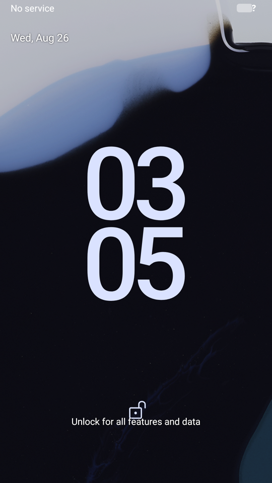
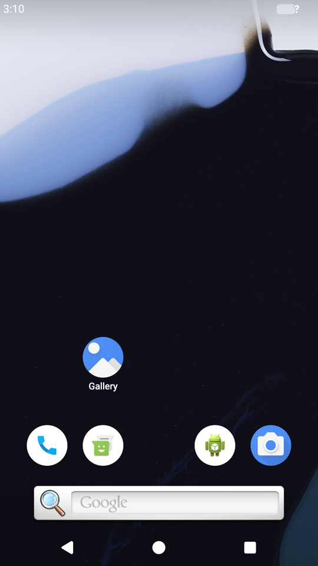
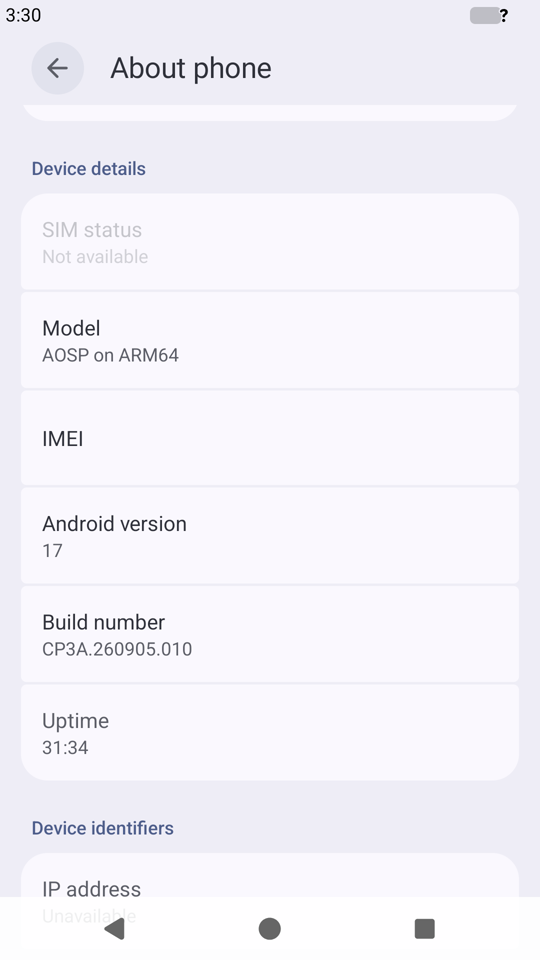
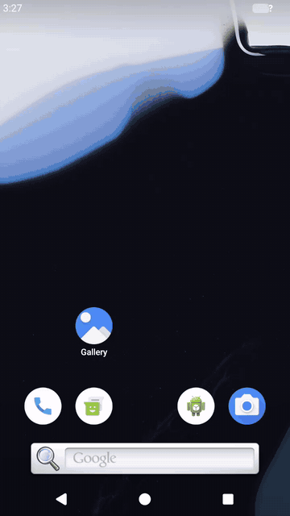

# Android 17 on the Nexus 5X (mainline Linux 6.12)

> **Disclaimer.** This is an experiment: I'm trying out what Claude can do
> with an old phone. The scripts, patches and text were written with Claude.
> They boot on one Nexus 5X, but they may be wrong, unsafe or complete
> garbage, and nothing here has been reviewed by anyone who knows these
> drivers. Read it as notes from an experiment, not a reference, and use it at
> your own risk.

Google's official **Android 17 GSI** (`aosp_arm64-exp`, build
`CP3A.260905.010`, a *user* build) running on the LG Nexus 5X (bullhead,
Snapdragon 808 / MSM8992). It
boots on the kernel.org **Linux 6.12** port from
[nexus5x-linux-6.12-ubuntu-26.04LTS](https://github.com/kaiwalyakhasnis/nexus5x-linux-6.12-ubuntu-26.04LTS),
and the **Adreno 418 GPU** draws it with **Mesa freedreno**, built here with
the Android NDK. No AOSP tree and no framework build: the PC this was made on
is far too slow for that.

Beyond display and touch, **Wi-Fi**, **all 16 sensors**, **brightness and
auto-brightness**, the **notification LED**, the **vibrator** and the
**battery level** work
through Android's normal APIs, with HALs built from the SDK and NDK alone.
[docs/](docs/) has one page per service: how it was brought up and tested.

| Lock screen | Home screen (round icons, 3-button nav) | Settings → About phone |
|:---:|:---:|:---:|
|  |  |  |



*Android 17's "bubble any app": Contacts opened from the app drawer as a
bubble, expanded, then collapsed to the edge. Recorded on the phone with
`screenrecord` ([mp4](media/bubble-contacts.mp4)); it's choppy because the
video is encoded in software (no hardware encoder yet), the screen itself is
smoother. [Gallery as a bubble](media/bubble-gallery.gif).*

## What works and what doesn't

| | Part | How |
|---|---|---|
| ✅ | Official Android 17 GSI, user build, SELinux enforcing | GSI on `system`; every domain made permissive in the vendor policy (bring-up) |
| ✅ | Boot to lock screen and home screen, apps, Settings, bubbles | `sys.boot_completed=1`, system_server stable |
| ✅ | GPU rendering (SurfaceFlinger, HWUI) | Mesa 26.0.3 freedreno, `renderer: FD418`, OpenGL ES 3.1 |
| ✅ | Display on the panel | the emulator's HWC3 in "client" mode on the msm MDP5 (KMS) |
| ✅ | Touchscreen | mainline `rmi4` |
| ✅ | adb (over the USB network), rescue root shell | `adb connect 172.16.42.1:5555`, `telnet 172.16.42.1` |
| ✅ | Sensors: accelerometer, gyroscope, compass, barometer, light, proximity, steps, rotation vectors, gravity (16) | the nanohub on SPI: ported kernel driver + our NDK-built AIDL HAL; see [docs/sensors.md](docs/sensors.md) |
| ✅ | Brightness slider, auto-brightness, notification LED | PMI8994 WLED + LPG (mainline drivers) and our NDK-built lights HAL; see [docs/lights.md](docs/lights.md) |
| ✅ | Wi-Fi: scan, connect, internet (2.4 and 5 GHz) | mainline `ath10k` (the base project's PCIe), the emulator's generic Wi-Fi HAL and `wpa_supplicant`; see [docs/wifi.md](docs/wifi.md) |
| ✅ | Battery level and charging state in the status bar | a read-only PMI8994 charger/fuel-gauge status driver; see [docs/battery.md](docs/battery.md) |
| ✅ | Vibrator: notifications, calls, touch feedback, apps | a new PMI8994 haptics driver (LRA motor) and our NDK-built vibrator HAL; see [docs/vibrator.md](docs/vibrator.md) |
| ⚠️ | Charging speed | the PMIC charges on its own defaults: USB 500 mA mode, so slowly, and it pauses when the battery gets hot. No battery voltage or temperature in Android yet |
| ✅ | KeyMint, Gatekeeper, health, power, thermal (software HALs) | from Google's Android 17 emulator vendor image |
| ✅ | zram swap | half the RAM, compressed |
| ✅ | Boots by itself | `boot`, `system`, `vendor`, `userdata` all flashed on the eMMC; no PC needed |
| ⚠️ | Boot reliability | ~1 boot in 6 the RPM doesn't answer (base project's known issue), worse after button resets; the ramdisk detects it and restarts after 30 s (or `boot.main.kts` retries from the PC) |
| ❌ | Suspend | blocked with a wakelock: the phone never wakes from s2idle |
| ❌ | Bluetooth, modem, audio, camera, GNSS, RTC | no driver or HAL yet (emulator ones removed) |
| ❌ | Hardware video codecs | software codecs only |

## How it fits together

```
 PC (USB cable)                         Nexus 5X
 ──────────────                         ───────────────────────────────────────────
 fastboot boot ─────────────────────▶   LK ─▶ Linux 6.12 + this project's ramdisk
                                              /init (rootfs/init) = first-stage init:
                                              USB network + rescue telnet, modules,
                                              mounts system + vendor, then
                                              chroot … /system/bin/init selinux_setup
 adb / telnet  ◀────  USB NCM  ────▶          │
                                              ▼
                                        eMMC:  system   = Android 17 GSI (as released)
                                               vendor   = out/vendor.img (below)
                                               userdata = /data
```

* **GKI doesn't fit.** A real GKI kernel (built in a side project) is 40 MiB
  in memory; the Nexus 5X's bootloader (LK) only loads ~29.5 MiB. So it's the
  mainline 6.12 kernel with Android's options added
  ([config/android.config](config/android.config)): binder, SELinux, PSI,
  cgroup v1 cpuset/memcg, EROFS, device-mapper, ... It comes to 27.9 MiB; the
  networking stack netd needs (IPv6, netfilter, xfrm, tc) is modules on
  `/vendor`, loaded by the ramdisk.
* **The vendor image** is the vendor partition of Google's Android 17 arm64
  *emulator* image: the only prebuilt Android 17 vendor there is, with the same
  SELinux version (202604) as the GSI and pure-software HALs that work on any
  hardware. [scripts/make-vendor.main.kts](scripts/make-vendor.main.kts) edits it with
  `debugfs` (no root needed) and labels every file it adds the way Android's
  file_contexts say: our init script and fstab, kernel modules, Mesa, the A420
  microcode, a circular-icon overlay, permissive SELinux domains, and it
  removes the emulator-only HALs (sensors, modem, GNSS, camera, ...).
* **Mesa** ([scripts/build-mesa.main.kts](scripts/build-mesa.main.kts)): freedreno only,
  with the base project's Adreno 418 patch, `-Dplatforms=android
  -Dandroid-stub=true`, libdrm static. Buffers are described by u_gralloc's
  fallback path (one linear plane).
* **gralloc and composer** are the emulator's minigbm and ranchu HWC3, taught
  about msm: minigbm's dumb-buffer driver list gets "msm" (a same-length
  string edit), and an `LD_PRELOAD` shim ([tools/hwc-msm-shim.c](tools/hwc-msm-shim.c))
  tells the composer the msm device is the virtio-gpu it looks for. Stopgaps
  until minigbm's msm backend and drm_hwcomposer are built properly.

## What it took

Each of these stopped the boot somewhere; most were found from the kernel log
streamed over the USB network ([scripts/watch-boot.main.kts](scripts/watch-boot.main.kts)).

1. **apexd**: some APEX payloads are EROFS, and compressed APEXes are mounted
   through dm-verity (both modules).
2. **bpfloader** is `reboot_on_failure`: Android 17's netd program for kernels
   ≥ 6.12.75 calls `bpf_get_netns_cookie()` from cgroup_skb programs, which
   Android's common kernel allows and kernel.org doesn't
   ([patches/0002](patches/0002-bpf-allow-bpf_get_netns_cookie-in-cgroup_skb-and-tc-.patch)).
3. **netd** flushes every `ip rule` at start, which took the route to the PC
   (and adb) with it: the ramdisk keeps a rule for the USB subnet.
4. **cgroups**: 6.12 only builds the v1 cpuset/memcg controllers Android still
   mounts with `CPUSETS_V1`/`MEMCG_V1`.
5. **ashmem** is gone from kernel.org Linux, and Android 17 only picks memfd by
   itself when SELinux has the `memfd_class` capability (6.12 hasn't):
   `sys.use_memfd=true`.
6. **Missing HALs that are declared** make system_server wait forever
   (sensors): the emulator ones are removed from the VINTF manifest.
7. **The emulator vendor image uses ext4 `shared_blocks`** (deduplicated
   blocks). Deleting a file with debugfs freed blocks other files still used,
   and the next write corrupted the power/thermal APEXes:
   `e2fsck -E unshare_blocks` first.
8. **GPU memory accounting**: Android 17 aborts system_server when the
   `gpuMem` BPF map is missing, and its program can't load here (its
   tracepoint is Android-kernel-only). The ramdisk pins an empty stand-in
   ([tools/phone/BpfMapStub.kt](tools/phone/BpfMapStub.kt)), but only after bpfloader
   has finished: a map already there makes bpfloader fail, which reboots.
9. **The A418 doesn't come back from runtime suspend** (GPU hang on resume,
   and it autosuspends after 66 ms): kept powered.
10. **Graphics memory**: there's no IOMMU, so every buffer (windows, textures)
    comes from one contiguous carveout; 256 MB ran out once a few apps were
    open ("drawRenderNode called on a context with no surface!"). Now
    `msm.vram=448m cma=512M`, plus zram.
11. **Dumb buffers on the render node** ([patches/0003](patches/0003-drm-allow-the-dumb-buffer-ioctls-on-render-nodes.patch)),
    so gralloc never opens the primary node and takes DRM master away from the
    composer.
12. **Suspend**: once the screen goes off, Android suspends the system and the
    phone never wakes: a kernel wakelock blocks it.
13. **The navigation bar** needs `qemu.hw.mainkeys=0` (no hardware keys), and
    **round icons** are a vendor overlay on `config_icon_mask`
    ([vendor/overlay-iconcircle](vendor/overlay-iconcircle)).
14. Don't `pm disable-user com.android.bluetooth`: Android 17's system_server
    then refuses to start ("Conflicting system configuration detected").

## Build and boot

Needs, next to this repository, the base project checked out as
`../nexus5x-linux-6.12-wip` (its patches, DTS, kernel config, BusyBox build
and `mkbootimg.py`; or set `BASE=`), the kernel.org 6.12.112 tarball and a
static BusyBox from it (`TARBALL=`, `BUSYBOX=`), the Android SDK (build-tools:
aapt2, apksigner, aidl, d8) and the ~5 GB of downloads below.

The scripts and the ramdisk's tools are Kotlin: the scripts are Kotlin
scripts (`*.main.kts`, run on the JVM) and the tools in `tools/phone/` are
one static Kotlin/Native binary for arm64. Only `rootfs/init` (BusyBox `sh`),
the HWC shim (C) and the HALs in `hal/` (C++, they live in Android) aren't.

```sh
# downloads (not in git): accept the Android 17 GSI licence on
# developer.android.com first
#   downloads/gsi/aosp_arm64-exp-CP3A.260905.010-*.zip   -> extracted/system.img
#   downloads/emu/arm64-v8a-37.0_r06.zip (SDK repo)     -> extracted/arm64-v8a/
#   downloads/mesa/mesa-26.0.3.tar.xz, tools/android-ndk-r28c (NDK)
#   downloads/linux-firmware/: a420_pm4.fw a420_pfp.fw LICENSE.qcom (GPU),
#     firmware-6.bin notice_ath10k_firmware-6.txt regulatory.db{,.p7s} (Wi-Fi)
#   backup/vendor-mmcblk1p39.img: the stock vendor partition (Wi-Fi calibration;
#     or STOCK_VENDOR=)
python3 -m venv tools/venv && tools/venv/bin/pip install meson ninja mako packaging pyyaml

# Kotlin 2.2.21: the compiler (for the scripts) in tools/kotlinc, and
# Kotlin/Native (for tools/phone) in ~/.konan; a JDK 21 (8 works, slowly)
curl -LO https://github.com/JetBrains/kotlin/releases/download/v2.2.21/kotlin-compiler-2.2.21.zip
unzip -d tools kotlin-compiler-2.2.21.zip
curl -L https://github.com/JetBrains/kotlin/releases/download/v2.2.21/kotlin-native-prebuilt-linux-x86_64-2.2.21.tar.gz | tar xz -C ~/.konan
export PATH=$PWD/tools/kotlinc/bin:$PATH JAVA_HOME=/usr/lib/jvm/java-21-openjdk-amd64

scripts/build-kernel.main.kts    # kernel + modules (out/kernel, out/modules)
scripts/build-mesa.main.kts      # out/mesa/lib64/egl/*_mesa.so
scripts/build-overlays.main.kts  # out/overlay/*.apk
scripts/build-hal.main.kts       # out/hal/: sensors, lights, vibrator HALs (SDK aidl + NDK; fetches ~7 MB of AOSP)
VENDOR_SIZE=248M scripts/make-vendor.main.kts   # out/vendor.img, the partition's size
scripts/build-bootimg.main.kts   # out/boot-android-rev-{10,101}.img (+ tools/phone)

# once: flash system, vendor, userdata (back them up first:
# scripts/backup-partition.main.kts, from the base project's BusyBox boot)
fastboot flash boot    out/boot-android-rev-10.img  # or rev-101: fastboot getvar version-hardware
fastboot flash system  downloads/gsi/extracted/system.img
fastboot flash vendor  out/vendor.img
fastboot flash userdata out/userdata.simg   # an empty ext4, 11771295744 bytes

scripts/boot.main.kts            # or, without flashing boot: fastboot boot, with retries
adb connect 172.16.42.1:5555     # scripts/tsh.main.kts 'cmd' (or telnet 172.16.42.1) for a root shell

scripts/build-apps.main.kts      # test apps: out/apps/{SensorTest,LightsTest}.apk (SDK only, no Gradle)
adb install -r out/apps/SensorTest.apk
```

The boot and vendor images go together: the vendor image's sensors HAL
expects the kernel's hub driver (`/dev/nanohub`), and its Wi-Fi script loads
`ath10k` from the kernel's module directory.

`android.disks=nbd` on the kernel command line serves system/vendor/data from
the PC instead ([scripts/serve.main.kts](scripts/serve.main.kts)), with nothing on the
phone written; that's how the first boots were done.

## Layout

| Path | What it is |
|---|---|
| [config/android.config](config/android.config) | Android's kernel options, on top of the base project's `kernel.config` |
| [docs/](docs/) | one page per hardware service brought up: hardware, kernel, HAL, testing, what it took ([sensors](docs/sensors.md), [lights](docs/lights.md), [Wi-Fi](docs/wifi.md), [battery](docs/battery.md), [vibrator](docs/vibrator.md)) |
| [patches/](patches/) | kernel patches on top of the base project's series (DRM, BPF, the sensor hub, battery status, vibrator) |
| [dts/](dts/) | device tree additions, included by the base project's boards: the sensor hub (SPI, GPIOs, power), the RGB LED, battery status, the vibrator |
| [rootfs/init](rootfs/init) | the ramdisk's first-stage init: USB network, rescue telnet, disks, watchdogs, BPF stand-in, wakelock |
| [vendor/](vendor/) | `init.bullhead.rc`, `fstab.bullhead`, overlays (icon shape; LED and auto-brightness), the Wi-Fi init script |
| [hal/](hal/) | our HALs, C++ on the stable binder NDK API: [sensors](hal/sensors/), [lights](hal/lights/), [vibrator](hal/vibrator/) (built by [build-hal.main.kts](scripts/build-hal.main.kts)) |
| [apps/](apps/) | test apps on the public SDK API: [Sensor Test](apps/sensortest/), [Lights Test](apps/lightstest/) (built by [build-apps.main.kts](scripts/build-apps.main.kts)) |
| [scripts/lib.main.kts](scripts/lib.main.kts) | what the scripts share: paths, running commands, the phone's telnet shell, fastboot |
| [scripts/make-vendor.main.kts](scripts/make-vendor.main.kts) | emulator vendor image → bullhead vendor image (also builds the HWC shim) |
| [scripts/build-mesa.main.kts](scripts/build-mesa.main.kts) | Mesa freedreno for Android with the NDK |
| [scripts/build-kernel.main.kts](scripts/build-kernel.main.kts), [build-bootimg.main.kts](scripts/build-bootimg.main.kts) | kernel and boot image |
| [scripts/boot.main.kts](scripts/boot.main.kts), [watch-boot.main.kts](scripts/watch-boot.main.kts), [tsh.main.kts](scripts/tsh.main.kts) | boot with retries, stream the kernel log, run commands in the rescue shell |
| [scripts/serve.main.kts](scripts/serve.main.kts), [backup-partition.main.kts](scripts/backup-partition.main.kts) | disks over NBD from the PC; raw partition backups with checksums |
| [tools/phone/](tools/phone/) | the ramdisk's programs, one Kotlin/Native binary: `reboot-now`, `reboot-to`, `wait-power-key`, `bpf-map-stub`, `nanohub-test`, `vibrate` |
| [tools/hwc-msm-shim.c](tools/hwc-msm-shim.c) | the composer's `LD_PRELOAD` shim (C: it lives inside an Android process) |

Kernel patches are GPL-2.0, like the kernel they apply to.
