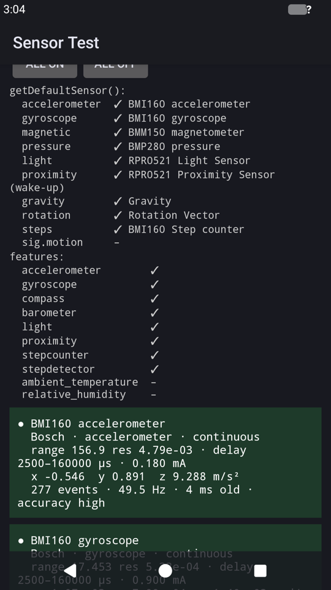
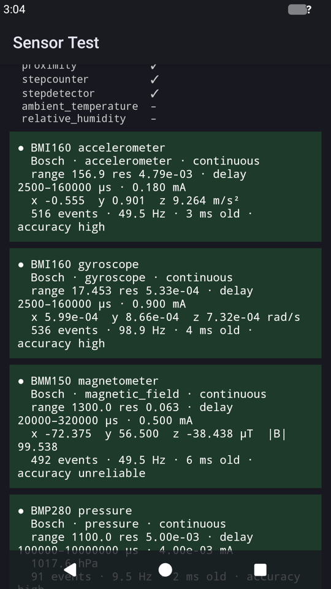

# Sensors

All 16 of the Nexus 5X's sensors reach Android 17 through the standard API:
`SensorManager`, `getDefaultSensor()`, auto-rotate, compass and step apps all
see them as on the stock phone. Each sensor reports live data at its requested
rate, typically 3–20 ms after it was measured.

| Sensor Test: what apps see | All sensors on, live |
|:---:|:---:|
|  |  |

```
 App (any, from Play too)     SensorManager.getDefaultSensor(...), registerListener(...)
        │  Java API
 sensorservice (GSI, as released)
        │  AIDL android.hardware.sensors.ISensors/default, version 3
        │  + two shared-memory queues (events out, wake-lock acks back)
 hal/sensors (vendor, ours)   /vendor/bin/hw/android.hardware.sensors-service
        │  read()/write() on /dev/nanohub: the hub's messages
 kernel driver (ours)         drivers/staging/nanohub  (patches/0004)
        │  SPI 9.6 MHz + WAKEUP / IRQ handshake lines
 nanohub: STM32F411 with Google's firmware (already in its flash)
        │  I²C / SPI on the hub's side
 BMI160 accel+gyro · BMM150 compass · BMP280 pressure · RPR0521 light+proximity
```

## The hardware

On the Nexus 5X no sensor is wired to the Snapdragon. They all sit behind the
**nanohub**, Google's sensor hub: an STM32F411 microcontroller running its
own firmware. The firmware reads the sensors, does the sensor fusion
(rotation vector, gravity, step counting, gestures) and talks to the SoC over
SPI. Its firmware is in the STM32's own flash and was still there, so nothing
on the hub had to change.

Where this came from (the LineageOS tree in `~/Desktop/android/lineage`):

| What | Stock source |
|---|---|
| wiring: SPI bus, GPIOs | `kernel/lge/bullhead`: `msm8992-bullhead-sensorhub.dtsi`, `msm8992-bullhead-pinctrl.dtsi` |
| power | `msm8992-bullhead-regulator.dtsi` |
| kernel driver | `drivers/staging/nanohub/` (3.10, ~3,800 lines) |
| the hub's protocol, sensor handling | `device/google/contexthub/sensorhal/hubconnection.cpp` |
| bullhead's sensor list, scales | `device/lge/bullhead/sensorhal/sensorlist.cpp` |

## Kernel

**Driver**: [patches/0004](../patches/0004-staging-nanohub-the-Nexus-5X-sensor-hub-data-path-on.patch),
the bullhead 3.10 driver ported to 6.12 as `drivers/staging/nanohub`:

- **data path only.** The STM32 bootloader code and the firmware/app
  download paths are left out on purpose: nothing in this kernel can write the
  hub's flash.
- `/dev/nanohub` (sensor events), `/dev/nanohub_comms` (app messages),
  read-only sysfs (`firmware_version`, `app_info`, `wakeup`) and `reset`, in
  `/sys/class/nanohub/nanohub/`
- updated for 6.12: GPIO descriptors instead of numbers, `wakeup_source`
  instead of Android wakelocks, no empty IIO device, `ktime_get_boottime_ns()`
- the hub's start-up (enabling its interrupt) runs in the reader thread, not in
  probe, so a silent hub can't hold up the boot
- built in (`CONFIG_NANOHUB=y` in [config/android.config](../config/android.config)):
  only the boot image changes

**Device tree**: [dts/bullhead-sensorhub.dtsi](../dts/bullhead-sensorhub.dtsi),
which `build-kernel.main.kts` copies next to the base project's DTS and
includes from the `*-learn.dts` boards:

| | |
|---|---|
| SPI | BLSP2 QUP1 (`spi@f9963000`, stock `spi_7`), GPIO 41/42/44, GIC 101, 9.6 MHz |
| hub lines | CS GPIO 43 (driven by the driver), NRESET 59, BOOT0 60 (kept low), WAKEUP 65, IRQ 66 (pulled up) |
| power | PM8994 L18 (3.0 V), L19 (1.8 V), LVS2 always on |

**Testing without Android**: `nanohub-test` (in the ramdisk's Kotlin tools,
[tools/phone/NanohubTest.kt](../tools/phone/NanohubTest.kt)) turns one hub
sensor on and prints its events, from the rescue shell:

```
$ scripts/tsh.main.kts '/sbin/nanohub-test'           # firmware version, apps
hw type: 4275 hw ver: 0000 bl ver: 0001 os ver: 0000 variant ver: 00000310
app: 0 id: 476f6f676c000002 ...                        # 13 apps
$ scripts/tsh.main.kts '/sbin/nanohub-test accel 10 2'
t=17230 ms  1.475 0.810 8.981 m/s^2
```

(While Android runs, the HAL is reading `/dev/nanohub` too: the two would
take each other's events.)

## Android

### The HAL: hal/sensors, with the SDK and NDK only

Android 17 wants an AIDL `android.hardware.sensors` HAL, version 2 or 3. The
2017 one in the LineageOS tree is the old C-style HAL v1, built inside AOSP. So
[hal/sensors](../hal/sensors/) is a new, small AIDL HAL (~900 lines) that
reuses the stock HAL's knowledge: the hub's messages, the sensor list, raw
scales, calibration handling.

It is built without an AOSP checkout by
[scripts/build-hal.main.kts](../scripts/build-hal.main.kts):

| Needed | From |
|---|---|
| the interface (`ISensors.aidl`, frozen version 3, plus the two it imports) | AOSP `hardware/interfaces`, sparse git clone, ~5 MB |
| C++ code for it | the SDK's `build-tools/35.0.1/aidl --lang=ndk` |
| binder's C++ helpers and service-manager headers | AOSP `frameworks/native/libs/binder/ndk`, ~1 MB |
| `AServiceManager_addService` (missing from the NDK's stub library) | linked against the GSI's own `/system/lib64/libbinder_ndk.so` |
| compiler | the NDK's clang, libc++ linked in statically |

So only C interfaces cross into Android (`libbinder_ndk`, `liblog`, `libc`).
They are the stable ones, so the HAL keeps working when the GSI is updated.

Pieces worth knowing:

- **The event queue** ([Fmq.h](../hal/sensors/Fmq.h)). sensorservice sends
  the HAL a Fast Message Queue to write events into. `libfmq` is C++ and not in
  the NDK, so this is a ~100-line version of it. It maps the shared memory the
  descriptor's "grantors" point at: read counter, write counter, data ring,
  event flag word. It copies events in and wakes the reader with
  `FUTEX_WAKE_BITSET`, as `libfmq`'s `EventFlag` does. Events go across as
  raw bytes: the generated `Event` is a fixed-size tagged union (96 bytes in
  both processes; the HAL checks this at `initialize`).
- **Binder stability.** A VINTF HAL's binder must be marked VINTF-stable, or
  servicemanager refuses it. The generated code only does that when built
  with `-D__ANDROID_VENDOR__ -DBINDER_STABILITY_SUPPORT`, as Soong builds
  vendor code.
- **The hub protocol** ([Sensors.cpp](../hal/sensors/Sensors.cpp)), from
  `hubconnection.cpp`:
  - To turn a sensor on, write a 20-byte `ConfigCmd`: event 0x300, latency,
    rate in Hz × 1024, hub sensor type, enable/disable.
  - Events arrive as `0x200 + hub sensor type`: a boot-clock timestamp, then
    samples. There are three sample kinds: 1 float, 3 floats, or 3 raw int16
    (accelerometer ×16 g·9.81/32768, compass ×1/16 µT).
  - Several Android sensors can share one hub sensor (the accelerometer and
    the uncalibrated accelerometer): the hub runs at the fastest rate either
    asks for.
  - After a hub reset (event 0x403), every enabled sensor is configured again.
  - The hub's own log lines (`ALOG` events) go to logcat, tag
    `sensors.bullhead`.
- **No batching.** Events are sent as they come (latency 0, FIFO sizes 0),
  so `flush()` is complete at once.
- **Wake-up sensors.** Proximity must be wake-up, or
  `getDefaultSensor(TYPE_PROXIMITY)` returns null. The framework acknowledges
  wake-up events through a second queue, which the HAL just keeps empty. It
  holds no wake lock, since the phone never suspends (README: Suspend).
- **No hub, no hang.** The sensors HAL is declared in the VINTF manifest, so
  system_server waits for it at boot. If `/dev/nanohub` is missing (a kernel
  without the driver), the HAL still registers, with no sensors, instead of
  exiting.

### In the vendor image

[scripts/make-vendor.main.kts](../scripts/make-vendor.main.kts) adds:

| File | Why |
|---|---|
| `/vendor/bin/hw/android.hardware.sensors-service` | the HAL. This exact name already has the `hal_sensors_default_exec` SELinux label in the emulator's `file_contexts`, so init starts it in the existing sensors HAL domain; no policy change |
| `/vendor/etc/init/android.hardware.sensors-service.rc` | starts it (class hal, user system) |
| `/vendor/etc/vintf/manifest/android.hardware.sensors-service.xml` | declares `ISensors/default` v3: what sensorservice looks for |
| `/vendor/etc/permissions/android.hardware.sensors.bullhead.xml` | the step counter/detector features; ambient temperature and humidity (claimed by the emulator's `handheld_core_hardware.xml`) marked unavailable |
| `/vendor/etc/ueventd.rc` + 2 lines | `/dev/nanohub*` owned by `system` |

The emulator's own sensors HAL (multihal, virtio) stays removed.

## Testing: the Sensor Test app

[apps/sensortest](../apps/sensortest/) is a plain Android app using only the
public SDK API. [scripts/build-apps.main.kts](../scripts/build-apps.main.kts)
builds it with the SDK alone (aapt2, kotlinc, d8, zipalign, apksigner; no
Gradle) into `out/apps/SensorTest.apk`. It shows:

- every sensor with its properties: vendor, type, reporting mode, wake-up,
  range, resolution, delays
- what `getDefaultSensor()` returns for the common types, and the
  `android.hardware.sensor.*` features (what Play filters apps on)
- live values per sensor (tap to start or stop), with the measured rate, the
  event's age and its accuracy. Rotation vectors are shown as
  azimuth/pitch/roll.

```sh
adb install -r out/apps/SensorTest.apk
adb shell pm grant dev.nexus5x.sensortest android.permission.ACTIVITY_RECOGNITION
adb shell am start -n dev.nexus5x.sensortest/.MainActivity --ez all_on true --ez log true
adb logcat -s SensorTest      # every sensor's line every 2 s
```

What it showed (phone lying on a desk):

| Sensor | Value | Rate (asked: 50 Hz) |
|---|---|---|
| accelerometer | (−0.55, 0.90, 9.26) m/s² | 49.5 Hz, 3 ms old |
| gyroscope | ~0.001 rad/s | 98.9 Hz |
| magnetometer | 99.5 µT, accuracy unreliable (not calibrated yet) | 49.5 Hz |
| pressure | 1017.6 hPa | 9.5 Hz (its maximum, 10) |
| proximity | 5 cm (far), wake-up | on change |
| light | 0 lx | on change |
| gravity, linear acceleration, 3 rotation vectors | consistent with the accelerometer | 20–40 Hz |
| step counter, step detector | (no steps taken) | |

Also: `adb shell dumpsys sensorservice` lists the 16 sensors and the last
events of each; with the HAL in place the system itself uses the
accelerometer (auto-rotate) and proximity.

## What it took

Porting the driver was the expected part. These were not, and each cost a
round of debugging on the phone. They're in order, because each one hid the
next:

1. **The hub had no power.** The stock kernel keeps three regulators always
   on with no consumer: L18 3.0 V, L19 1.8 V and LVS2. They are the hub's and
   the sensors' rails. Mainline describes L18/L19 but leaves them off, and has
   no LVS2.
   - Symptom: every byte read over SPI was `0x00`.
   - Found by: listing `/sys/class/regulator` (both the RPM and the SPMI views)
     against the stock regulator file.
   - The voltages are fixed in the DT (min = max), so enabling them can only
     ever apply the stock values.
2. **The hub's interrupt line needs a pull-up.** The hub only pulls IRQ
   (GPIO 66) low.
   - Without the SoC's pull-up it read low all the time. The driver then
     took that as "the hub answered at once" and sent requests before it was
     awake.
   - The stock pinctrl has `bias-pull-up` on that pin.
3. **The SPI clock rounds up.** 10 MHz requested became 15 MHz, the next
   rate of the QUP clock.
   - Found in `/sys/kernel/debug/clk/clk_summary`.
   - Now exactly 9.6 MHz, which is about what stock ran at.
4. **RPM failure boots.** On the roughly 1-in-6 boots where the RPM doesn't
   answer (README: Boot reliability), the regulators never come up, so the
   hub is dead for that boot. That's not a driver bug: the ramdisk restarts
   the phone, as before.
5. Smaller ones:
   - `sysfs_emit()` warns unless given a sysfs page buffer.
   - Kotlin block comments nest: a `/*` inside a KDoc comment silently
     commented out the rest of a build script.
   - The `kotlin` script runner exports `KOTLIN_RUNNER=1`, and a `kotlinc`
     started from a script inherits it and stops compiling.
   - Android 11+ refuses APKs whose `resources.arsc` is compressed.

## Not done yet

- **Calibration storage.** The stock HAL saves the hub's accelerometer, gyro
  and compass calibration to `/persist/sensorcal.json` and sends it back at
  boot. Here the hub recalibrates from zero each boot: the compass shows
  "unreliable" until it is moved in a figure 8.
- **More sensors.** The hub also offers significant motion (wake-up,
  one-shot), tilt, pickup, double tap and twist gestures, and its internal
  temperature. They need the one-shot handling or private sensor types.
- **Batching.** The hub has a large FIFO; with suspend working, batching
  would let it collect samples while the SoC sleeps.
- **Direct channels** (`registerDirectChannel`) are not supported, which is
  allowed.
